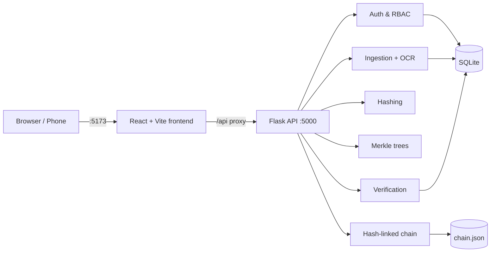

# ⛓️ ChainCert

**Tamper-evident academic certificate issuance & verification** — built with Python/Flask, SQLite, Merkle trees, a hash-linked audit chain, and a React + Vite frontend.

ChainCert lets institutions issue digital certificates whose integrity can be verified by anyone — by ID, share link, uploaded PDF, or by **scanning the QR code** printed on the certificate. Any modification to a certificate (or to the underlying records) is detected.

---

## ✨ Features

- **Certificate issuance** — single and bulk issuance by institution admins / issuers
- **Public verification** — by certificate ID, direct link, PDF upload (OCR), or QR scan
- **Tamper detection** — SHA-256 hashing + Merkle proofs + hash-linked chain (`data/chain.json`)
- **QR codes on certificates** — scan from a phone to instantly see the integrity result
- **Role-based access control** — Platform Admin, Institution Admin, Issuer, Student, Public Verifier
- **Secure auth** — Argon2 password hashing, signed tokens, optional TOTP
- **Audit & integrity dashboard** — verification history and chain validation
- **Student portal** — view credentials, download PDF certificates, share verification links

## 🏗️ Architecture



## 📁 Repository structure

```text
ChainCert/
├── app.py                 # Flask entry point
├── chaincert/             # Backend packages
│   ├── api/               # REST routes (/api/v1)
│   ├── auth/              # Users, roles, policies, tokens
│   ├── chain/             # Hash-linked audit chain
│   ├── hashing/           # Canonical hashing
│   ├── ingestion/         # PDF/OCR ingestion
│   ├── merkle/            # Merkle tree + proofs
│   ├── records/           # Certificate storage
│   └── verification/      # Verification engine
├── frontend/              # React + TypeScript + Vite app
├── templates/, static/    # Server-rendered demo pages
├── scripts/               # Utilities (e.g. fake certificate generator)
├── tests/                 # Pytest API & end-to-end tests
├── data/                  # Local SQLite DBs + chain.json (DBs are git-ignored)
├── DEMO_RUNBOOK.md        # Step-by-step demo guide
└── v0/                    # Earlier version of the project (archived)
```

## 🚀 Getting started

### Prerequisites
- Python 3.10+
- Node.js 18+ and npm
- Tesseract OCR (`sudo apt-get install -y tesseract-ocr` / `brew install tesseract`)

### 1. Backend
```bash
git clone https://github.com/Ameya-Walvekar1/ChainCert.git
cd ChainCert
python3 -m venv .venv && source .venv/bin/activate
pip install -r requirements.txt
cp .env.example .env        # then set real secrets
python3 app.py              # http://127.0.0.1:5000
```

### 2. Frontend
```bash
cd frontend
npm install
npm run dev                 # http://localhost:5173
```

### 3. Scanning QR codes from a phone
The dev server listens on your LAN, and QR codes automatically embed your machine's Wi-Fi IP.
- Keep the phone on the **same Wi-Fi** network
- Allow the port through your firewall: `sudo ufw allow 5173/tcp`
- To override the address, set `VITE_PUBLIC_ORIGIN=http://<ip>:5173` in `frontend/.env.local` (or `LAN_IP=<ip>` when starting Vite)

## ⚙️ Configuration (`.env`)

| Variable | Purpose |
|---|---|
| `CHAINCERT_SECRET_KEY` | Flask secret key (≥ 32 chars) |
| `CHAINCERT_TOKEN_SECRET` | Auth token signing secret (≥ 32 chars) |
| `CHAINCERT_CORS_ORIGINS` | Allowed frontend origins |
| `CHAINCERT_DEMO_EMAIL` / `CHAINCERT_DEMO_PASSWORD` | Demo admin account |

## 🔐 Demo credentials

| Role | Email | Password |
|---|---|---|
| Institution | `institute@chaincert.local` | `Institute12345` |
| Student | `student@chaincert.local` | `Student123456` |

> ⚠️ For local demos only — change all secrets and credentials before any deployment.

## 🧪 Tests

```bash
pytest tests/
```

Generate a tampered certificate to test detection:
```bash
python3 scripts/make_fake_certificate.py
```

## 🔎 How verification works

1. On issuance, certificate fields are canonicalised and hashed (SHA-256).
2. Hashes are added as Merkle leaves; the root is recorded in the hash-linked chain.
3. On verification, the certificate is re-hashed and checked against its Merkle proof and the chain.
4. Any mismatch (edited field, altered PDF, revoked record, broken chain link) is reported as **tampered / invalid**.

See [`DEMO_RUNBOOK.md`](DEMO_RUNBOOK.md) for a full walkthrough.

## 🛠️ Tech stack

**Backend:** Flask · SQLite · PyMuPDF · Pillow · pytesseract · argon2-cffi · itsdangerous
**Frontend:** React · TypeScript · Vite · React Router

## 👤 Author

**Ameya Walvekar** — [@Ameya-Walvekar1](https://github.com/Ameya-Walvekar1)
